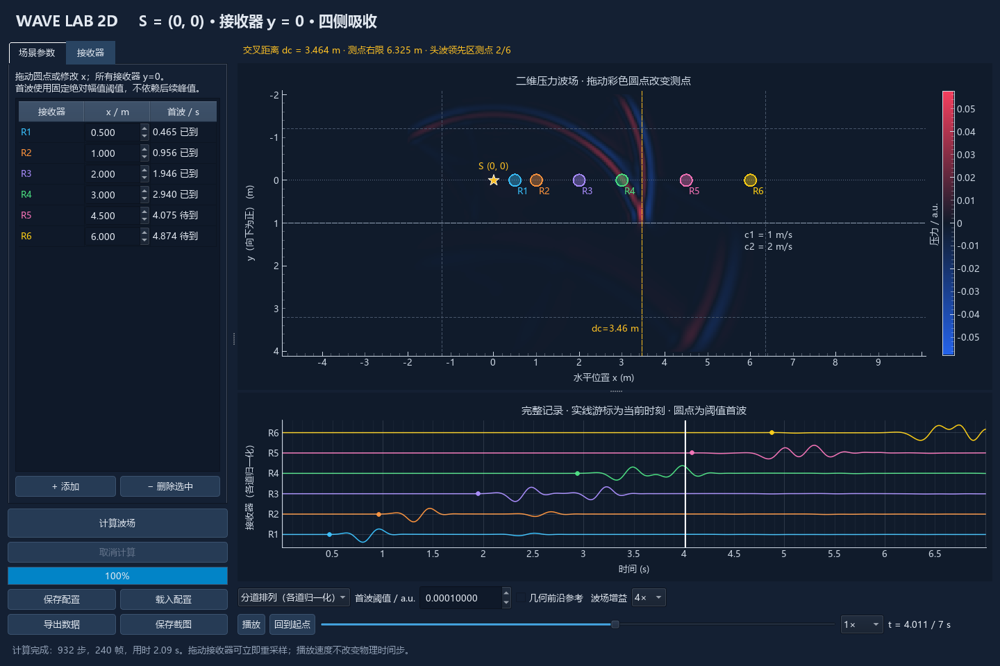
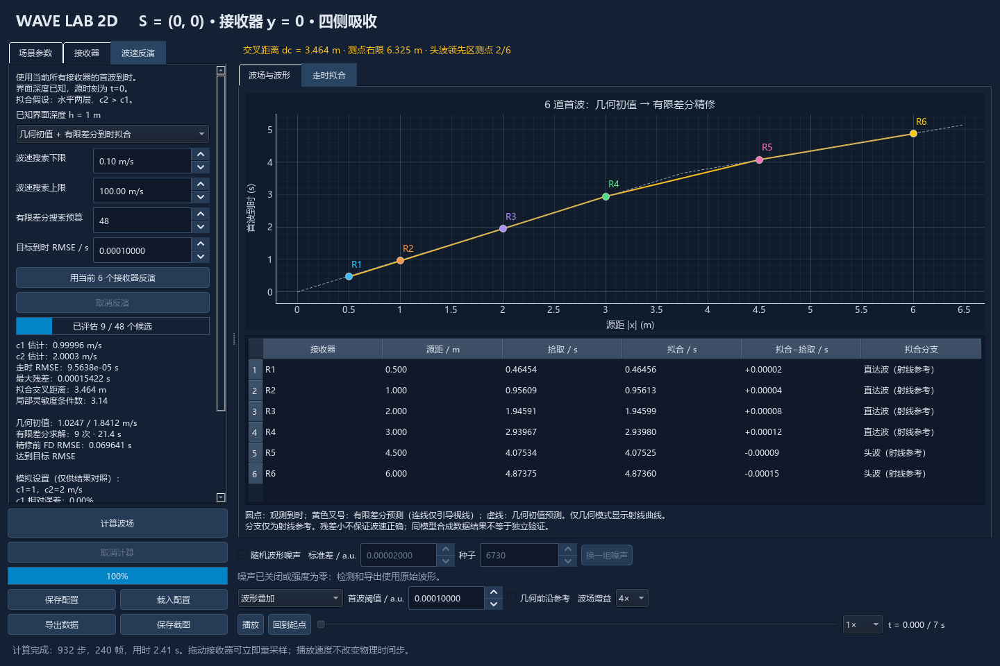

# WaveSimulator

**二维双层介质波传播与首波到时反演桌面软件。** 可观察波源发射、界面反射与透射、接收器记录，并从多个接收器的首波到时估计两层波速。应用窗口显示名称为 **Wave Lab 2D**，界面为中文。

本仓库仅包含可独立运行的软件、示例场景、测试和复现脚本。



## 功能

- 使用有限差分求解真实二维标量波场，支持暂停、回放、倍速和时间滑块。
- 波源中心固定在 `(0, 0)`；接收器固定 `y=0`，可拖动或输入水平位置。
- 接收器数量可增减，至少保留一个；实际容量受内存和绘图性能限制。
- 显示各接收器完整波形，支持叠加或分道显示及绝对幅值门槛拾取。
- 可开关高斯波形噪声，调整标准差和随机种子；关闭后立即恢复原始记录。
- 已知界面深度时，利用当前全部接收器估计 `c1`、`c2`。
- 默认采用**几何射线初值 + 有限差分首波到时精修**，另有仅几何模式作快速对照。
- 后台计算、进度显示、取消、输入检查、可辨识性诊断和结果失效管理。
- 自动按交叉距离规划右边界；保存/载入 JSON 场景，导出 CSV、NPZ、反演历史和截图。

## 安装与启动

本地验证环境为 **Windows、Python 3.13**。建议使用独立虚拟环境。其他操作系统尚未做桌面验证。

### Windows

在仓库目录的 PowerShell 中运行：

```powershell
python -m venv .venv
.\.venv\Scripts\python.exe -m pip install -r requirements.txt
.\.venv\Scripts\python.exe run_wave_lab.py
```

如果电脑通过 Python Launcher 管理版本，第一行也可改为 `py -3.13 -m venv .venv`。这些命令不需要激活虚拟环境或修改 PowerShell 执行策略。

安装完成后，双击 **`Start_Wave_Lab.cmd`** 即可启动；启动器优先使用仓库内 `.venv`，不存在时使用 PATH 中的 `python`。这是 Python 源码应用，仓库不包含打包好的 EXE。

开发测试和 GIF 导出需要额外依赖：

```powershell
.\.venv\Scripts\python.exe -m pip install -r requirements-dev.txt
```

`requirements.txt` 与 `requirements-dev.txt` 固定直接依赖版本；`requirements-lock.txt` 记录本次 Windows 独立环境的完整依赖版本。需要复现该验证环境时安装 `-r requirements-lock.txt`，Windows CI 也使用该文件。

### macOS（Mac）

Mac 可以按以下方式从 Python 源码启动。**目前没有在 Mac 上实测，也没有 macOS CI；以下是安装和运行步骤，不代表已验证兼容性。** 当前 PySide6 6.11.2 提供 macOS 13 及以上的 Intel / Apple Silicon 安装包；更旧的系统不能直接按当前依赖版本安装。参见 [PySide6 安装包](https://pypi.org/project/PySide6/6.11.2/)。

**1. 安装 Python 3.13，取得软件代码。**

- 从 [Python 官网 macOS 下载页](https://www.python.org/downloads/macos/) 选择 **Python 3.13 的 macOS 64-bit universal2 installer** 并安装。该安装器适用于 Intel 与 Apple Silicon；无需安装 Windows 软件或 EXE。参见 [Python 官方 Mac 使用说明](https://docs.python.org/3.13/using/mac.html)。
- 本仓库是私有仓库：先接受仓库邀请并登录 GitHub，再打开仓库页面，点击 **Code → Download ZIP**，解压到自己的文件夹。已使用 Git 的用户也可以通过自己的 GitHub 身份克隆仓库。
- 打开 macOS 的 **终端（Terminal）**，检查 Python：

```bash
python3.13 --version
```

应显示 `Python 3.13.x`。如果提示 `command not found`，先关闭并重新打开终端；仍找不到时检查 Python 3.13 是否安装成功。

**2. 在终端进入解压后的软件目录。**

例如，下载文件位于默认“下载”目录，解压后的文件夹名为 `WaveSimulator-main`：

```bash
cd ~/Downloads/WaveSimulator-main
ls README.md requirements.txt run_wave_lab.py
```

若放在别处，请替换 `cd` 后的路径；有空格的路径需要加引号。也可以在终端输入 `cd `（末尾留一个空格），把 Finder 中的软件文件夹拖入终端，再按回车。`ls` 应能列出这三个文件，不能在 ZIP 内或错误的上级目录执行后续命令。

**3. 首次安装依赖并启动。**

```bash
python3.13 -m venv .venv
.venv/bin/python -m pip install --upgrade pip
.venv/bin/python -m pip install -r requirements.txt
.venv/bin/python run_wave_lab.py
```

这会在当前软件文件夹创建 Mac 自己的虚拟环境并打开桌面窗口。**不要从 Windows 复制 `.venv`，也不要使用 `.venv/Scripts/python.exe` 或双击 `Start_Wave_Lab.cmd`；Mac 的解释器路径是 `.venv/bin/python`。** 上述步骤无需激活环境或使用 `sudo pip`，也不需要手动另装 Qt。

**4. 以后再次启动。**

进入同一个软件目录后，只需：

```bash
.venv/bin/python run_wave_lab.py
```

不需要每次创建环境或重新安装依赖。软件打开后，按下面“第一次使用”的步骤计算波场、播放、移动接收器和反演即可。目前没有提供可双击运行的 Mac `.app` 安装包。

**可选：在 Mac 上运行测试或导出 GIF。**

```bash
.venv/bin/python -m pip install -r requirements-dev.txt
mkdir -p tmp
.venv/bin/python -m pytest tests -q -p no:cacheprovider --basetemp=tmp/pytest_mac
```

运行 `scripts/` 中的复现或 GIF 导出脚本时，同样用 `.venv/bin/python` 替换示例中的 `python`。测试使用 Qt offscreen，Windows 专用样式的检查在该样式不可用时会跳过；测试通过也不能替代 Mac 原生窗口的操作检查。

**常见情况：**

- `No module named ...`：确认用的是 `.venv/bin/python`，并用同一个解释器重新执行依赖安装命令。
- 找不到 `requirements.txt` 或 `run_wave_lab.py`：检查终端是否位于解压后的软件根目录。
- `No matching distribution found`：核对 Python 版本、macOS 版本和 pip 输出中的具体包名；不要通过删除依赖版本限制来掩盖兼容问题。
- 字体或控件尺寸与截图不同：当前界面优先指定 Windows 字体，Mac 可能使用替代字体，显示效果尚待实测。若出现缺字、按钮遮挡或启动错误，请保留终端报错，并记录 macOS 版本及 Intel / Apple 芯片类型。

## 第一次使用

1. 保持默认场景，点击左下方 **“计算波场”**，等待计算完成。
2. 点击 **“播放”**，观察上方波场和下方接收器波形；白色游标表示当前回放时刻。
3. 在 **“接收器”** 页增删测点、修改 x，或直接拖动波场上的彩色标记。所有接收器保持 y=0。
4. 调整 **“首波阈值 / a.u.”**；可勾选 **“随机波形噪声”**，设置标准差和种子。
5. 打开 **“波速反演”** 页，保持默认混合方法，点击 **“用当前 N 个接收器反演”**。
6. 在 **“走时拟合”** 页查看速度估计、几何初值、预测拾取和逐道残差。计算可取消，原始观测会保留。
7. 点击 **“导出数据”** 并选择父目录；软件自动新建结果子目录。

拖动接收器表示重新选择一个固定测点，显示该位置从 t=0 开始的记录，不模拟移动传感器。调整测点、噪声和阈值无需重算波场；修改介质、网格或源参数需要重算。



## 坐标、模型和边界

x 为水平坐标，**y 向下为正**。上层速度为 c1，下层速度为 c2，水平界面位于 y=h。y=0 是源和接收器的观测线，**不是反射边界**；y<0 仍是上层介质的延伸。

软件求解常密度标量波动模型：

```text
u_tt + 2 gamma(x,y) u_t = c(y)^2 (u_xx + u_yy) + f(x,y,t)
```

采用二阶空间与时间差分；时间步满足 CFL 稳定性约束。源为具有有限空间范围的归一化高斯分布，时间函数为两周期有限脉冲。压力采用相对单位 a.u.。

上下左右使用海绵吸收层及最外缘一阶 Mur 出口，抑制人工返回波。它不是 PML，也不能保证所有频率和入射角下完全无反射。软件不模拟弹性剪切波、真实空气/地表边界、三维传播或任意复杂地质结构。

默认设置：

| 参数 | 默认值 |
|---|---|
| 波源、接收器观测线 | 源 `(0,0)`，接收器 `y=0` |
| 接收器 x / m | 0.5、1、2、3、4.5、6 |
| c1、c2 / m/s | 1、2 |
| 界面深度 h / m | 1 |
| 网格间距 / m | 0.025 |
| 模拟时长 / s | 7 |
| 源频率 / Hz | 3 |
| 绝对拾取门槛 / a.u. | 0.0001 |
| 随机噪声 | 默认关闭；开启后标准差默认 0.00002 |

当 c2>c1，源和接收器同处 y=0 时，交叉距离为：

```text
dc = 2 h sqrt((c2+c1)/(c2-c1))
```

自动右边界模式在默认 1.5 倍 dc 和最右测点之外，加上波长/网格缓冲及吸收层。1.5 是可调工程起点，不保证头波幅值足以被检测。自动规划不搬动接收器；黄色竖虚线与提示显示测点覆盖情况。c2≤c1 时没有该头波领先区，需使用手动边界。

## 反演如何工作

**已知：** 界面深度、测点坐标、发射时刻 t=0；有限差分精修还假定源波形和幅值、空间源形状、网格、区域、边界、采样时刻及门槛已知。**只估计 c1、c2，并要求 c2>c1。** 生成观测的真实波速仅用于结束后的误差对照，不用于初始化或确定搜索范围。

### 两阶段搜索

1. 几何阶段对每个源距 d=|x|，拟合 `min(d/c1, d/c2 + 2h sqrt(1/c1²-1/c2²))`，取得初值。
2. 精修阶段调整 c1、c2，重新执行二维有限差分模拟；在候选波形上用同一绝对门槛拾取首波时刻。
3. 最小化全部接收器的预测到时与观测到时的均方误差。使用局部数值灵敏度、步长限制和回溯；必要时使用坐标探测。

候选需要生成波形，但**目标只比较首波到时，不比较完整波形**。观测噪声在整个搜索中固定，候选波形不叠加噪声，也不复制随机种子来抵消噪声。候选保持原计算区域；必要时缩短内部时间步，再插值回观测时刻拾取。

### 控件和诊断

| 控件/结果 | 含义 |
|---|---|
| 波速搜索下限、上限 | 两个速度的共同搜索范围，默认 0.1–100 m/s |
| 有限差分搜索预算 | 最多评估的候选次数，默认 48，范围 8–200；灵敏度探测和无效候选也占预算 |
| 目标到时 RMSE / s | 默认 0.0001；停止标准，不是波速精度保证 |
| 到时 RMSE | 各接收器预测拾取与观测拾取之差的均方根 |
| 灵敏度条件数 | 局部估计稳定性的诊断，不是置信区间或全局唯一性证明 |
| 黄色叉号 / 灰色虚线 | FD 预测拾取 / 几何初值走时；黄色连接线只帮助阅读 |
| 拟合分支 | 基于估计速度的射线参考分类，不是接收器识别出的真实波型 |

达到目标、改进停滞或预算用尽时会停止；未达目标会明确提示。预算增大可能改善结果，也可能仅增加耗时。尚未通过公平计时对照证明该初始化方法的固定加速倍数。

至少两个不同的非零源距才能尝试同时确定两个速度；接收器数量多不等于信息充足。正负 x 的相同源距不是独立几何位置。仅有直达波等情况可能无法确定 c2；几何阶段无法给出可辨识初值时，不启动 FD 精修。某道未检出或非原点测点在 t=0 被噪声触发时会提示原因，不静默删除该道。

修改测点、噪声、门槛或反演参数会清除旧反演结果。播放、显示增益和波形排列不改变结果。

## 噪声与首波拾取

观测为 `干净波形 + sigma * N(0,1)`，各通道/时间采样点独立。使用 NumPy PCG64、`SeedSequence([seed, receiver_id])`；同一采样设置、通道编号及种子可复现噪声。改变显示、关闭后再开启或移动同一接收器不会随意重抽该通道噪声。

拾取规则是首次 `abs(u) >= threshold`，并线性插值得到跨越时刻。阈值采用绝对幅值，不依赖记录未来峰值。弱头波可能漏检，噪声可能提前触发；无噪声也仍存在源形状、阈值与数值离散造成的到时偏差。

## 示例与导出

内置 `scenes/`：

- `two_layer_wide.json`：覆盖近、远源距的两层场景。
- `two_layer_short.json`：较短测线，用于查看 c2 信息不足。
- `homogeneous.json`：均匀介质传播对照；不满足 c2>c1 的双层反演假设。

配置为 JSON schema v2，含场景、接收器、阈值和噪声；GUI 保存时还记录反演方法、上下限、预算和目标误差。旧 v1 坐标/拾取语义不同，会明确拒绝载入。

每次导出的目录包括：

| 文件 | 内容 |
|---|---|
| `configuration.json` | 可重新运行的场景及控制参数 |
| `signals.csv` | 当前观测波形，开启噪声时包含噪声 |
| `signals_clean.csv` | 无噪声记录 |
| `receivers.csv` | 坐标、门槛、拾取与几何参考到时 |
| `wavefield.npz` | 干净波场动画帧及全采样观测面 |
| `inversion.json` | 有效反演结果、几何初值、评价历史、停止原因；未反演时不存在 |
| `screenshot.png`、`README.txt` | 界面截图及单位/格式说明 |

波形保留每个求解时间步，不随动画抽帧。GUI 可载入 JSON 后重新计算，目前不直接载入 NPZ 回放。生成的 `output/`、临时文件和虚拟环境均不提交 Git；截图示例单独存放在 `docs/images/`。

## 测试与复现

安装开发依赖后执行：

```powershell
New-Item -ItemType Directory -Force tmp | Out-Null
.\.venv\Scripts\python.exe -m pytest tests -q -p no:cacheprovider --basetemp=tmp/pytest_local
```

软件测试覆盖二维解析解收敛、离散能量、界面反射/透射、吸收边界、缓存插值、噪声、拾取、射线及 FD 反演，以及 GUI 后台计算、取消、拖动、导出和数值箭头点击。GUI 自动测试使用 Qt offscreen；Windows 原生点击检查可另行运行。

```powershell
python scripts/verify_wave_lab.py
python scripts/verify_wave_noise.py
python scripts/verify_wave_inversion.py
python scripts/verify_wave_hybrid.py
python scripts/verify_spin_controls.py
python scripts/export_wave_animation.py output/wave_demo_auto --frames 80 --fps 15
```

运行脚本时请使用装有开发依赖的 Python（例如将上述 `python` 替换为 `.\.venv\Scripts\python.exe`）。脚本输出位于 `output/`；`verify_wave_lab.py` 也会重新生成内置示例场景。反演验证可能耗时数十秒到数分钟。

独立目录在全新虚拟环境（Windows / Python 3.13.13）中完成 **96 项测试，全部通过，耗时 50.63 秒**；原生 Windows 11 样式、150% 缩放下的 **52 次数值箭头点击**也通过。记录保存在 `docs/verification/`。CI 工作流在 Windows/Python 3.13 上安装依赖并运行软件测试，实际运行状态以仓库 Actions 页面为准。

## 结果应如何解读

同模型合成数据可用于检查优化实现，却不能单独证明真实地层反演精度。局部可辨识性、很小的数据残差或单个场景的高精度，都不保证全局唯一、无偏或对所有测点布置有效。

当前没有统计置信区间、自动正则化或真实地层验证。网格、阈值、有限频率、弱头波与模型失配都可能改变结果。此软件适用于分层标量波与首波反演的教学、可视化和受控合成实验。

## 代码结构

```text
wave_lab/model.py          二维求解器、源、边界、拾取、噪声、配置与导出
wave_lab/inversion.py      有界双层射线到时反演
wave_lab/hybrid.py         几何初始化后的 FD 到时优化
wave_lab/app.py            PySide6 / pyqtgraph 桌面界面
wave_lab/assets/           数值输入框箭头图标
scenes/                   三个独立示例
tests/                    软件数值与 GUI 测试
scripts/                  验证、截图和 GIF 导出
docs/                     软件截图与本地验证记录
run_wave_lab.py            Python 启动入口
Start_Wave_Lab.cmd         Windows 启动入口
```
